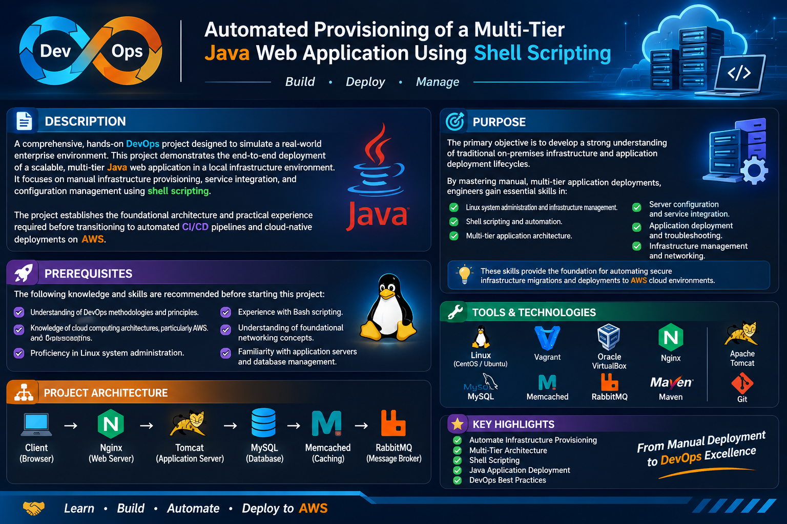
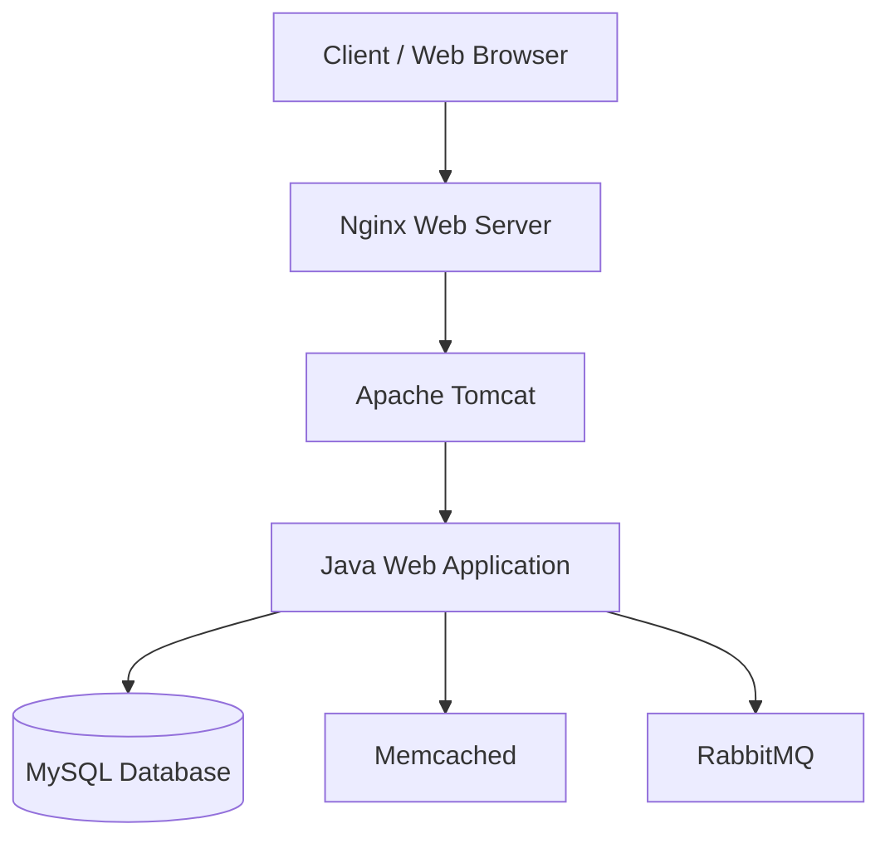
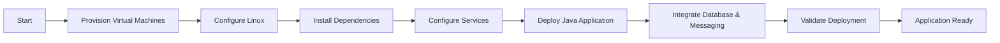

# 🚀 Automated Provisioning of a Multi-Tier Java Web Application Using Shell Scripting

<p align="center">
  
</p>

<p align="center">
  
  
  
  
  
</p>

<p align="center">
  <b>Build • Provision • Configure • Deploy • Automate</b>
</p>

---

## 📌 Project Overview

A comprehensive, hands-on **DevOps project** designed to simulate a real-world enterprise environment.

This project demonstrates the end-to-end provisioning and deployment of a scalable, multi-tier Java web application within a local infrastructure environment.

It focuses on infrastructure provisioning, server configuration, service integration, application deployment, and automation using **Shell Scripting**.

The project provides a strong foundation in traditional infrastructure management before transitioning toward modern CI/CD pipelines and cloud-native deployments on **AWS**.

---

## 🎯 Project Objectives

- Automate infrastructure provisioning using shell scripts.
- Understand multi-tier application architecture.
- Configure and integrate Linux-based infrastructure services.
- Deploy Java web applications using Apache Tomcat.
- Configure web servers, databases, caching, and messaging services.
- Develop practical troubleshooting and system administration skills.
- Build a foundation for CI/CD and cloud infrastructure automation.

---

## 🏗️ Project Architecture

The application follows a multi-tier architecture, separating web, application, and supporting service components.



### Architecture Components

| Component | Role |
|---|---|
| Client | Accesses the application through a browser |
| Nginx | Web server and reverse proxy |
| Apache Tomcat | Java application server |
| Java Application | Application business logic |
| MySQL | Persistent relational data storage |
| Memcached | Caching layer |
| RabbitMQ | Message broker for asynchronous communication |

---

## 🛠️ Technology Stack

<p align="center">
  
</p>

| Technology | Purpose |
|---|---|
| **Linux (CentOS / Ubuntu)** | Operating system and infrastructure platform |
| **Bash / Shell Scripting** | Provisioning and configuration automation |
| **Vagrant** | Virtual machine provisioning and lifecycle management |
| **Oracle VirtualBox** | Virtualization platform |
| **Nginx** | Web server and reverse proxy |
| **Apache Tomcat** | Java application server |
| **Java** | Application development and runtime |
| **MySQL** | Relational database management |
| **Memcached** | Distributed caching |
| **RabbitMQ** | Message queuing and messaging |
| **Maven** | Build and dependency management |
| **Git** | Version control |

---

## ⚙️ Infrastructure Provisioning Workflow



### Deployment Stages

1. **Infrastructure Provisioning** – Prepare the virtual machines and infrastructure environment.
2. **Operating System Configuration** – Configure Linux servers and required packages.
3. **Service Installation** – Install web server, application server, database, and supporting services.
4. **Configuration Management** – Configure services and establish connectivity.
5. **Application Deployment** – Build and deploy the Java application.
6. **Integration** – Connect application components to MySQL, Memcached, and RabbitMQ.
7. **Validation & Troubleshooting** – Verify service status, application availability, and connectivity.

---

## 📚 Prerequisites

The following knowledge and skills are recommended:

- Linux system administration
- Bash scripting fundamentals
- DevOps methodologies and principles
- Networking fundamentals (DNS, IP, ports, firewall)
- Virtualization concepts
- Java application servers
- Database administration basics
- Cloud computing fundamentals, particularly AWS

---

## 📂 Project Structure

```text
.
├── README.md
├── scripts/
│   ├── setup.sh
│   ├── install_packages.sh
│   ├── configure_nginx.sh
│   ├── install_tomcat.sh
│   ├── configure_mysql.sh
│   └── deploy_application.sh
├── configuration/
│   ├── nginx/
│   ├── tomcat/
│   └── mysql/
├── application/
│   └── java-webapp/
├── assets/
│   └── devops-banner.png
└── Vagrantfile
```

> The directory structure above represents a suggested organization for the project. Adapt it to match the actual repository structure.

---

## 💡 Key Highlights

- Infrastructure provisioning through automation.
- Multi-tier application deployment.
- Linux server administration.
- Bash scripting and operational automation.
- Web and application server configuration.
- Database and middleware integration.
- Service troubleshooting and validation.
- Practical experience with traditional infrastructure environments.

---

## 🔐 DevOps Skills Demonstrated

<p align="center">
  
  
  
  
  
  
</p>

---

## 🔮 Future Improvements

The project can be extended with modern DevOps tools and practices:

- [ ] CI/CD pipeline implementation using Jenkins.
- [ ] Infrastructure as Code using Terraform.
- [ ] Configuration management using Ansible.
- [ ] Containerization using Docker.
- [ ] Container orchestration using Kubernetes.
- [ ] Migration to AWS cloud infrastructure.
- [ ] Monitoring using Prometheus and Grafana.
- [ ] Centralized logging and alerting.
- [ ] Security hardening and secrets management.

---

## ☁️ DevOps Learning Journey

This project represents an important step toward building a practical DevOps skill set.

**From manual infrastructure provisioning to automation. From traditional deployment to CI/CD. From local infrastructure to cloud-native environments.**

---

<p align="center">
  <b>Learn • Build • Automate • Deploy • Improve</b>
</p>

<p align="center">
  ⭐ If you find this project useful, feel free to star the repository.
</p>
